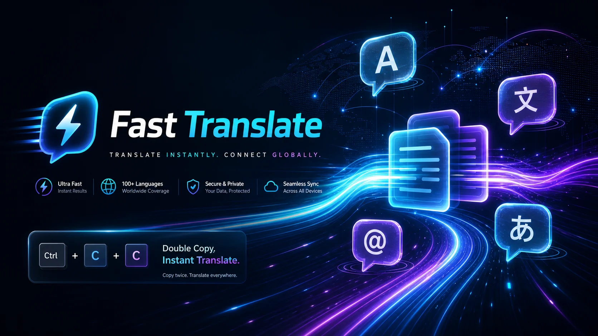
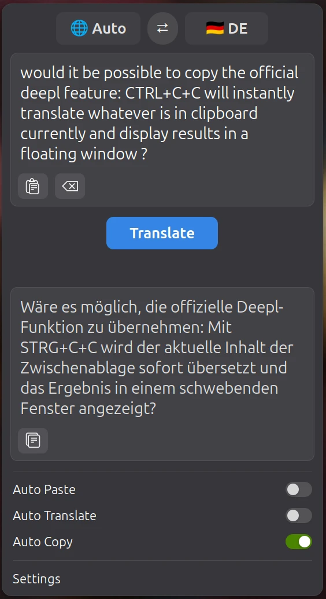
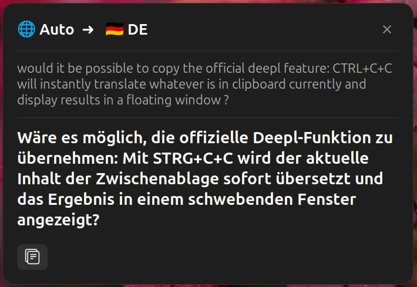

<!-- start project-info -->
<!--
project_title: Fast Translate
github_project: https://github.com/tazztone/translate-assistant
license: MIT
icon: icons/fast-translate-icon.svg
homepage: https://github.com/tazztone/translate-assistant
license-badge: True
contributors-badge: True
lastcommit-badge: True
--->

<!-- end project-info -->

<!-- start badges -->


[](https://buymeacoffee.com/tazztone)
<!-- end badges -->

<!-- start description -->
<h1 align="center">Welcome to <span id="project_title">Fast Translate for GNOME Shell</span> 👋</h1>
<p>
<a href="https://github.com/tazztone/translate-assistant" id="homepage" rel="nofollow">

</a>
</p>

> [!NOTE]
> This project is a modernized fork of the original [translate-assistant](https://github.com/atareao/translate-assistant) extension by [Lorenzo Carbonell (atareao)](https://github.com/atareao).

<span id="project_title">Fast Translate for GNOME Shell</span> is a GNOME Shell extension that brings **Google Translate and DeepL-powered translation** directly into your desktop — translate text from a panel popup or trigger instant clipboard translation with a configurable shortcut.



## ✨ Features

- **Panel menu translator** — a clean popover accessible from the GNOME top bar lets you type or paste text with `Ctrl+V` and translate it instantly.
- **Inline language selector** — switch source and target languages directly inside the popup using a flag-emoji grid, no settings window needed.
- **Quick Translate** — select text and press `Ctrl+Alt+E`; the extension copies the selection and translates it from any application, including browsers. Choose between a floating window or silent background translation that copies the result for immediate pasting.
- **Configurable shortcut** — `Ctrl+Alt+E` is the default and can be changed or cleared in the extension preferences.
- **Multiple Backends** — choose between Google Translate (works instantly out-of-the-box, no key required) and DeepL (Free & Pro tiers).

> [!NOTE]
> Google Translate needs no setup but uses a free endpoint that Google rate-limits per network (HTTP 429 — common on shared office/VPN connections). If a translation fails with a throttle error, wait a minute and retry, or switch to DeepL with a free API key for your own quota.

<!-- end description -->

<!-- start prerequisites -->

## Prerequisites

| Requirement | Details |
|---|---|
| GNOME Shell | 45 – 50 |
| DeepL API key | (Optional) [Free or Pro](https://www.deepl.com/pro-api) — only needed if choosing DeepL as your active provider |

<!-- end prerequisites -->

<!-- start installing -->

## Installing <span id="project_title">Fast Translate for GNOME Shell</span>

### From GNOME Extensions (recommended)

1. Visit the [Fast Translate page on extensions.gnome.org](https://extensions.gnome.org/extension/5124/translate-assistant/). *(Note: The extension will be submitted under Fast Translate)*
2. Toggle the switch to **On** — the browser integration installs and enables the extension automatically.

<!-- end installing -->

<!-- start using -->

## Using <span id="project_title">Fast Translate for GNOME Shell</span>

Once enabled, the extension icon appears in the GNOME top bar. Click it to open the translation popup, type or paste text with `Ctrl+V`, choose your languages, and hit **Translate**. With **Auto Paste** and **Auto Translate** enabled, opening the panel after copying text fills and translates it automatically.



### Quick Translate

Select text in any application and press `Ctrl+Alt+E`. The extension sends a single `Ctrl+C` to the active application, waits for the clipboard to update, and translates the copied selection. The shortcut works system-wide and can be reassigned in preferences. Depending on your preferences:

- **Default mode**: A floating window appears with the translated result — no focus stealing, no screen dimming.
- **Background mode**: The translation runs silently in the background and automatically updates your clipboard, allowing you to instantly paste (`Ctrl+V`) the translated text without distraction. An optional desktop toast notification is shown on completion.



### Preferences

Open **GNOME Settings → Extensions → Fast Translate → Settings** to configure:

- Active translation service (Google Translate or DeepL)
- DeepL API key & URL (automatically hidden when Google Translate is selected)
- Default source and target languages
- Quick Translate keybinding (default `Ctrl+Alt+E`)
- Auto-translate behavior
- Dark/light theme icons and notifications
- **Quick Translate Background Mode** (enable silent clipboard-to-clipboard translation)
- **Show Notification in Background Mode** (enable/disable completion toasts)

<!-- end using -->

<!-- start contributing -->

## Contributing to <span id="project_title">Translate Assistant for GNOME Shell</span>

### Local development commands

Run these commands from the project directory:

```bash
npm run build   # build the extension package
npm run apply   # install the existing package and reload the extension
npm run deploy  # build, install, and reload in one command
```

`npm run apply` verifies that the package is fresh before installing it. If a
GSettings schema change is not visible after deployment, log out of GNOME and
log back in.

1. Fork this repository.
2. Create a branch: `git checkout -b <branch_name>`.
3. Make your changes and commit them: `git commit -m '<commit_message>'`
4. Push to the original branch: `git push origin <branch_name>`
5. Create a pull request.

See the GitHub docs on [creating a pull request](https://help.github.com/en/github/collaborating-with-issues-and-pull-requests/creating-a-pull-request) for help.

<!-- end contributing -->

<!-- start contributors -->

## 👤 Contributors ✨

Thanks goes to these wonderful people ([emoji key](https://allcontributors.org/docs/en/emoji-key)):

<!-- end contributors -->

<!-- start table-contributors -->

<table id="contributors">
    <tr id="info_avatar">
        <td id="daPhipz" align="center">
            <a href="https://github.com/daPhipz">
                
            </a>
        </td>
        <td id="fabricio8800" align="center">
            <a href="https://github.com/fabricio8800">
                
            </a>
        </td>
        <td id="Vistaus" align="center">
            <a href="https://github.com/Vistaus">
                
            </a>
        </td>
        <td id="atareao" align="center">
            <a href="https://github.com/atareao">
                
            </a>
        </td>
    </tr>
    <tr id="info_name">
        <td id="daPhipz" align="center">
            <a href="https://github.com/daPhipz">
                <strong>Philipp Kiemle</strong>
            </a>
        </td>
        <td id="fabricio8800" align="center">
            <a href="https://github.com/fabricio8800">
                <strong>Fabrício Müller</strong>
            </a>
        </td>
        <td id="Vistaus" align="center">
            <a href="https://github.com/Vistaus">
                <strong>Heimen Stoffels</strong>
            </a>
        </td>
        <td id="atareao" align="center">
            <a href="https://github.com/atareao">
                <strong>Lorenzo Carbonell</strong>
            </a>
        </td>
    </tr>
    <tr id="info_commit">
        <td id="daPhipz" align="center">
            <a href="/commits?author=daPhipz">
                <span id="role">💻</span>
            </a>
        </td>
        <td id="fabricio8800" align="center">
            <a href="/commits?author=fabricio8800">
                <span id="role">💻</span>
            </a>
        </td>
        <td id="Vistaus" align="center">
            <a href="/commits?author=Vistaus">
                <span id="role">💻</span>
            </a>
        </td>
        <td id="atareao" align="center">
            <a href="/commits?author=atareao">
                <span id="role">💻</span>
            </a>
        </td>
    </tr>
</table>

<!-- end table-contributors -->

---

## 📄 License

[MIT](./LICENSE) © Lorenzo Carbonell Cerezo (atareao) & contributors

---

## 🤝 Credits & Attribution

This project is a fork of the original [atareao/translate-assistant](https://github.com/atareao/translate-assistant) extension by Lorenzo Carbonell Cerezo, licensed under the MIT License. Significant features (including Google Translate default backend, configurable Quick Translate, background mode, inline flag-emoji grid selection, high-DPI scaling, and integration tests) were added in this fork.

### Read aloud

Use the speaker at the top right of either text block in the panel or floating window to hear the original or translation. Click again to stop, or click the other speaker to switch. Speech is available only for nonempty text up to 500 Unicode characters; longer text is never truncated or sent for speech.

Speech uses the unofficial Google Translate online service without an API key, including when DeepL handles translation. Text is sent only after clicking the speaker; automatic language detection may also send it to Google. Service availability and supported languages can change. Install `gst-play-1.0` (commonly in `gstreamer1.0-plugins-base-apps`) and GStreamer MP3/audio output plugins. Temporary audio is removed when playback finishes or stops.
